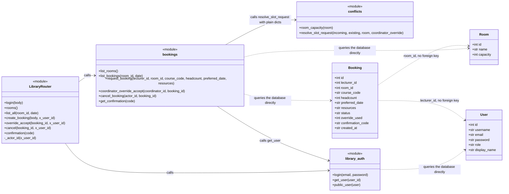
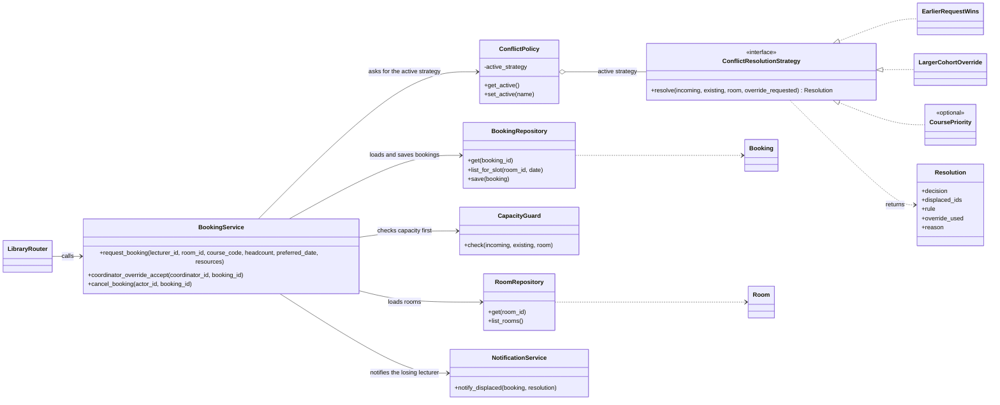

# Class Diagram: Inherited vs Proposed

Both diagrams show the same-slot conflict resolution feature (R4). The proposed design uses the Strategy pattern, as justified in pattern-rationale.md.

## Inherited structure

Weaknesses visible here: the whole conflict rule sits in one function in `conflicts`, `bookings` talks to the database directly (only users have a repository, and it is not used on this path), and decisions travel as plain dicts.

## Proposed design (Strategy)

## How the inherited code maps to the design

| Inherited | Proposed |
|---|---|
| `resolve_slot_request()`, one function with nested conditionals | `ConflictResolutionStrategy` with `EarlierRequestWins` and `LargerCohortOverride`. The capacity check moves to `CapacityGuard` |
| Module functions in `bookings.py` | `BookingService` class |
| Direct database queries in `bookings.py` | `BookingRepository` and `RoomRepository` |
| Plain dict verdict | `Resolution` |
| Nothing | `ConflictPolicy` (R9) and `NotificationService` (R5) |
| `Booking`, `Room`, `User` models | Unchanged, except `Booking` gains fields to store the Resolution |
